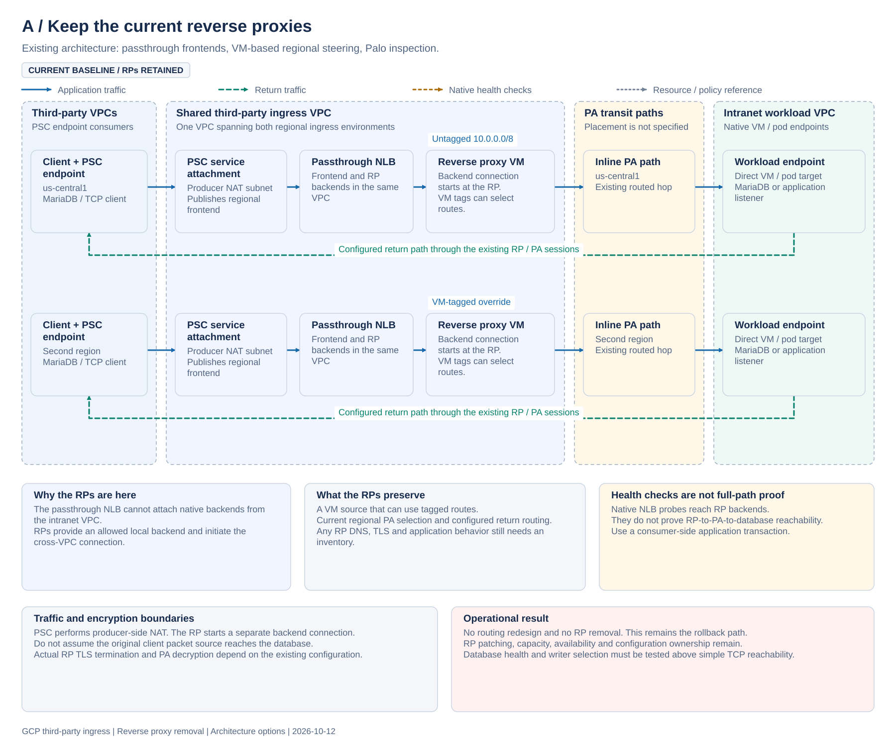
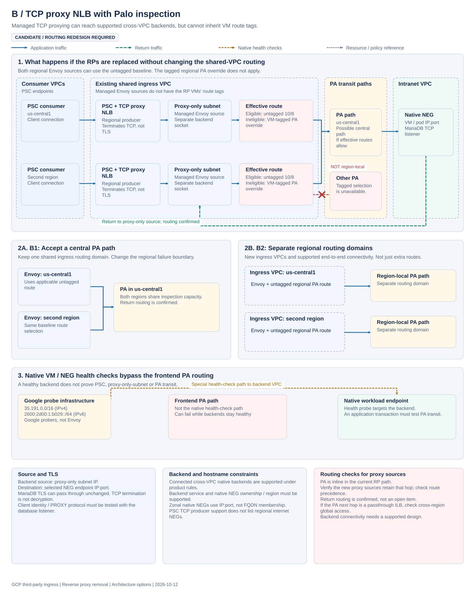
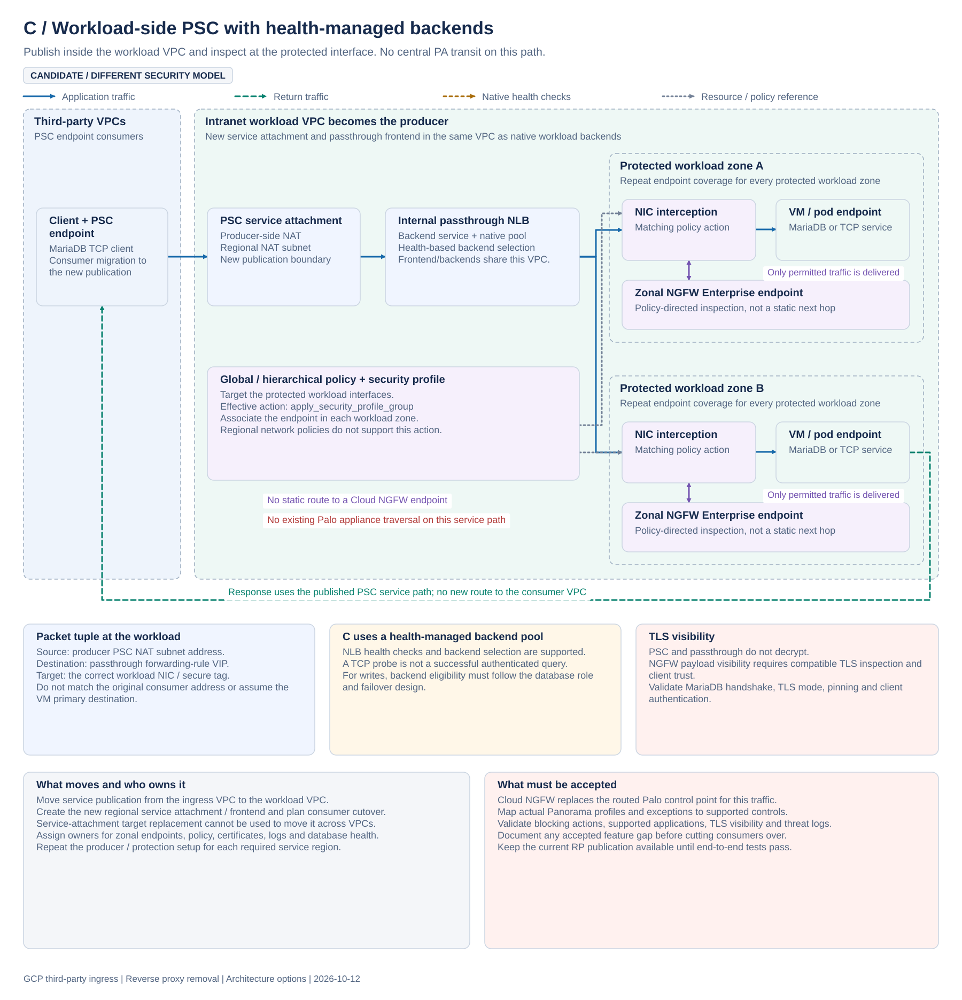
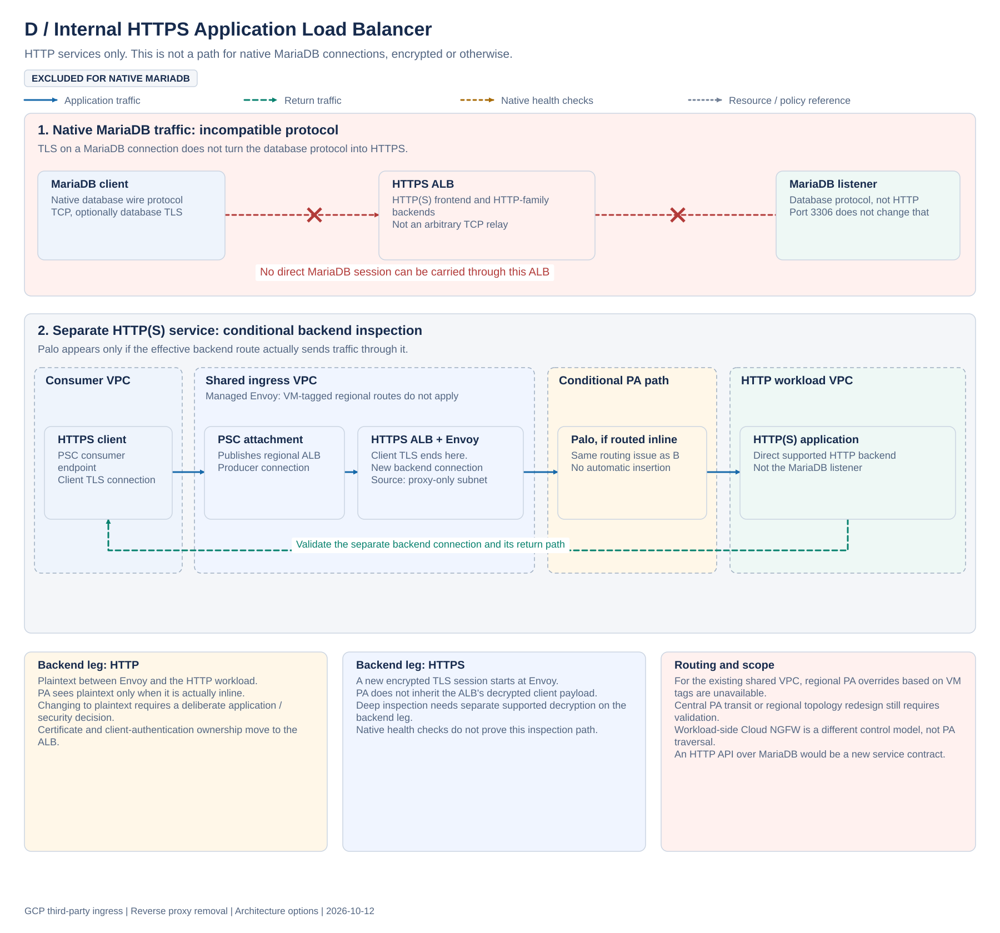
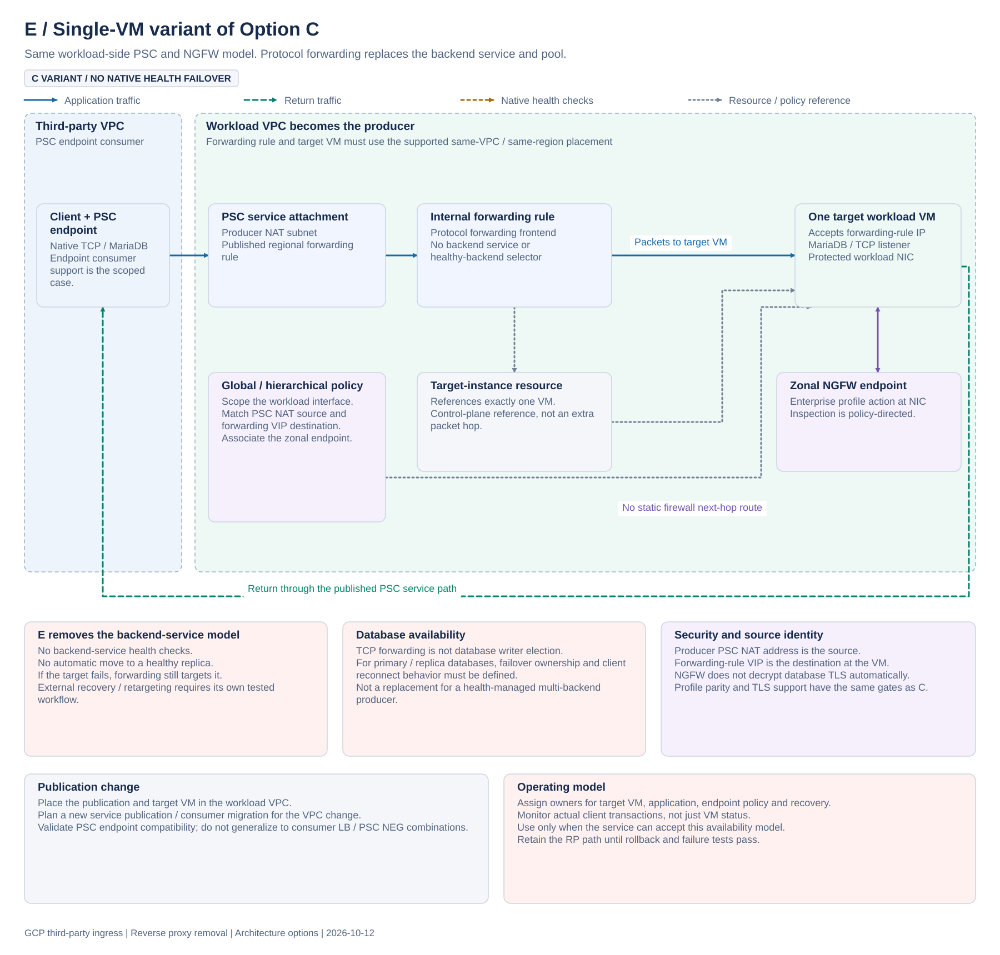
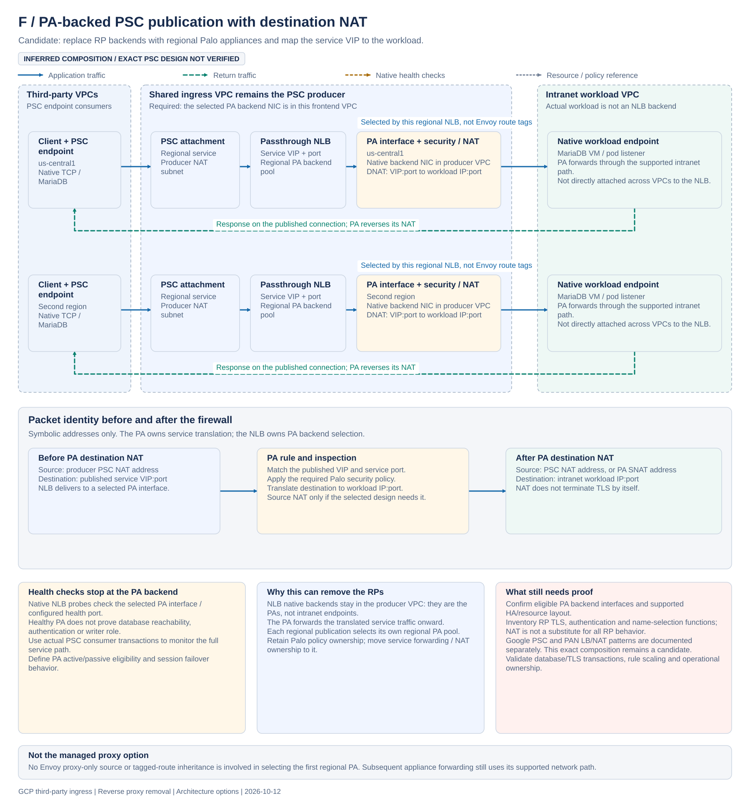
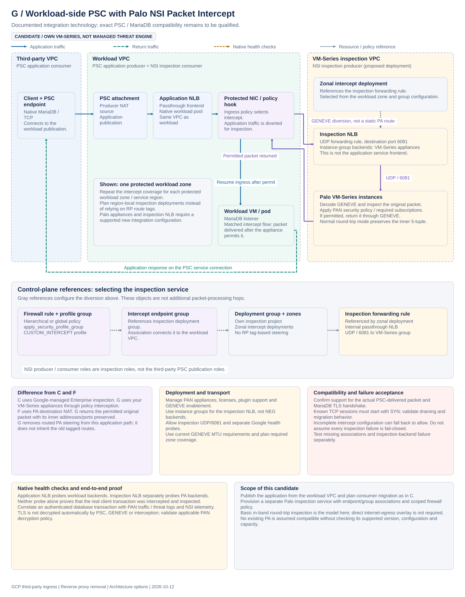

# ADR: Remove the GCP third-party ingress reverse proxies

- Status: Proposed
- Date: 2026-10-12
- Owner: Maximilian Browne
- Reviewers: Network Security, Cloud Platform Engineering, Application Teams
- Scope: Third-party PSC ingress to intranet workloads in two regions

Related: [GCP internet egress architecture](adr-gcp-internet-egress-architecture.md). That ADR covers outbound traffic and is not changed by this proposal.

## Problem

We want to remove the reverse proxy VMs without losing the Palo inspection path or the service behavior they provide today. Changing the load balancer is only part of that work. The RPs are also the traffic sources that make the current regional routing work.

The current path is:

```text
Third-party client
  -> PSC endpoint
  -> service attachment in the third-party ingress VPC
  -> internal passthrough Network Load Balancer
  -> reverse proxy VM
  -> regional Palo Alto path
  -> workload in the intranet VPC
```

Both regional ingress environments are in the same VPC. The untagged `10.0.0.0/8` static route points toward the PA path in `us-central1`. Selected VMs use tagged routes to reach the other regional PA path. The route is VPC-wide; the regional next hop does not restrict it to traffic from that region.

The current ILB is passthrough. Palo is an inline routed hop in the current path. Return routing is configured and confirmed for the path under discussion. It is not an open prerequisite. The passthrough type and inline PA placement are also confirmed. The passthrough frontend cannot attach native backends in the other VPC, which is why the RPs sit behind it and start the intranet connection.

The replacement would target native workload VM or pod endpoints, not another load balancer VIP. The exact project ownership and Shared VPC arrangement need to be checked against the replacement product's rules. Changing the traffic source from an RP to a managed proxy changes which forward routes are applicable. Regional PA selection remains the routing issue; return routing is already resolved.

Native MariaDB connections use a database protocol over TCP, with or without TLS. An HTTP(S) Application Load Balancer cannot carry that protocol.

## Recommendation

Keep the current path until a replacement has passed end-to-end tests in both regions.

If regional Palo inspection and the existing Palo controls must stay, test Option F for PA-backed publication with service DNAT, or Option G for workload-side publication with Palo NSI interception. Both are candidates, not qualified deployments. Option B remains available with a routing redesign; a managed TCP proxy cannot inherit the RP-tagged regional routes.

If replacing Palo for this traffic is acceptable, test Option C. Publishing PSC in the workload VPC with Cloud NGFW Enterprise removes the need for an RP or a central PA transit path. It also changes the security model, publication ownership and consumer migration plan.

Option D is only for separate HTTP(S) services. It is excluded for native MariaDB access. Option E is a single-VM variant of C for services that can accept no native health-based failover. Option A remains the baseline and rollback path.

No replacement has been selected for production.

## Option summary

| Option | Removes RPs | MariaDB transport | Inspection | Main constraint |
| --- | --- | --- | --- | --- |
| A. Keep the current RPs | No | Existing RP path | Existing regional Palo path | Keeps RP operations and lifecycle work |
| B. Internal TCP proxy NLB with Palo | Yes, once RP functions are replaced | TCP-capable; validate database connection behavior | Palo on the routed backend connection | Managed proxies cannot use the current VM-tagged regional overrides |
| C. Workload-side PSC, passthrough NLB and Cloud NGFW Enterprise | Yes | TCP-capable; validate database health and TLS inspection separately | Policy interception at the workload interface | Moves publication and replaces the Palo enforcement point for this traffic |
| D. Internal HTTPS Application Load Balancer | HTTP(S) services only | Not supported | Routed Palo backend leg or a separate workload-side NGFW model | Wrong protocol for MariaDB; same tagged-route problem as B |
| E. Single-VM variant of C using protocol forwarding | Yes | TCP-capable; validate listener and TLS behavior | Workload-side Cloud NGFW Enterprise | No backend pool, native health checks or automatic healthy-target selection |
| F. PA-backed PSC publication with DNAT | Yes, if remaining RP functions are replaced | TCP forwarding; database/TLS behavior needs proof | Regional PA backends apply security policy and service NAT | Inferred PSC/PAN composition; requires eligible producer-VPC PA interfaces and service NAT ownership |
| G. Workload-side PSC with Palo NSI Packet Intercept | Yes, if remaining RP functions are replaced | Candidate PSC/MariaDB combination needs qualification | Policy diversion to own VM-Series appliances | Moves publication; adds GENEVE/intercept deployment and appliance operations, with explicit failure acceptance |

The diagrams show architecture and packet behavior, not production resource names. The second region is labeled as such because its name was not supplied. PA paths are shown separately from VPC boundaries because the actual PA interface and next-hop resource layout is not specified here. Solid blue lines are application traffic, dashed green lines are returns, dotted amber lines are native health checks, dotted gray lines are resource or policy references, and purple lines are policy-directed inspection. Red marks identify rejected or bypass paths. Return lines summarize response direction on the same service connections; they do not represent a bypass around inspection. Open an SVG at full size to read the packet and operational notes.

## Option A: Keep the current reverse proxies

[](diagrams/third-party-ingress/option-a-current-reverse-proxies.svg)

[Open the full-size SVG](diagrams/third-party-ingress/option-a-current-reverse-proxies.svg)

Keep the existing PSC publications, passthrough frontends and RP VMs in the shared ingress VPC. The RP is a valid backend for the frontend because both are in that VPC. It then opens a connection toward the intranet workload using the applicable untagged or tagged PA route.

This preserves the current regional steering and configured return routes. It also preserves any DNS selection, TLS termination, client authentication, header handling, logging or connection management implemented by the RPs. We need an inventory of those functions before assuming the RP is just a TCP relay.

The native load balancer health check reaches the RP backend. That alone does not test the RP-to-PA-to-workload connection. The service needs an application transaction from an actual PSC consumer to prove that path.

The cost is unchanged: RP patching, sizing, scaling, failover and configuration remain our responsibility. This option does not meet the removal objective, but it provides a known rollback path.

## Option B: Internal TCP proxy NLB with Palo

[](diagrams/third-party-ingress/option-b-tcp-proxy-palo.svg)

[Open the full-size SVG](diagrams/third-party-ingress/option-b-tcp-proxy-palo.svg)

Replace the passthrough/RP layer with a regional internal TCP proxy NLB. Keep PSC publication in the ingress VPC and attach supported native workload backends in the connected intranet VPC.

```text
PSC -> TCP proxy NLB -> proxy-only subnet -> effective route -> PA -> workload
```

The proxy accepts the client-side TCP connection and opens a separate backend connection. Backend packets originate from the proxy-only subnet and target the selected endpoint IP and port. Native `GCE_VM_IP_PORT` backends can be in a different connected VPC, subject to the product's project and regional requirements. The regional backend service and its native NEG must have a supported same-project/same-region arrangement. This is not permission to reference arbitrary backend resources in another project. [TCP proxy networking](https://docs.cloud.google.com/load-balancing/docs/tcp/internal-proxy#backends_and_vpc_networks).

### Why the current regional steering does not carry over

Managed Envoy proxies do not have the RP VMs' route tags. They cannot use the tagged override toward the other regional PA. Changing that route's priority does not make it applicable.

The untagged `10/8` baseline can apply to both proxy regions. Where it wins route selection, both regions can use the `us-central1` PA path. That may provide connectivity, but it is not the current region-local inspection design. [Static route applicability](https://docs.cloud.google.com/vpc/docs/static-routes#route_parameters).

There are two designs to evaluate:

- **B1: Centralized inspection.** Keep the shared ingress VPC and deliberately send both regions through the `us-central1` PA path. Size it for both regions and accept the additional latency and shared failure boundary. If the next hop is an internal passthrough NLB, verify that global access permits the other region's traffic. [Next-hop requirements](https://docs.cloud.google.com/vpc/docs/static-routes#considerations_for_internal_passthrough_network_load_balancer_next_hops).
- **B2: Separate regional routing domains.** Put each regional ingress source in a routing domain with its own untagged PA route. Separate ingress VPCs are one design to investigate. They need supported backend ownership, PSC publication and connectivity. VPC peering alone does not provide transitive forwarding through an appliance.

Two untagged routes with different priorities do not select a PA based on the source region. Source-based or policy-based steering is not a solution until its applicability to the managed proxy and proposed topology is established.

Palo is already an inline routed hop in the current RP path. The routing check for Option B is whether the replacement's proxy-only sources retain that hop. Verify the effective forward route for those new source ranges. Return routing is confirmed. In the replacement design, a direct subnet or peering subnet route can take precedence over the broad PA static route; that is a design check for the new connection, not a claim that the current RP path bypasses Palo. [Route selection](https://docs.cloud.google.com/vpc/docs/routes#routing_order).

### Health checks, return traffic and TLS

For native `GCE_VM_IP_PORT` backends, health checks originate from Google probers using `35.191.0.0/16` for IPv4 or `2600:2d00:1:b029::/64` for IPv6. These are not Envoy probes from the proxy-only subnet. Google delivers them through its special health-check routing to the backend VM in the intranet VPC, rather than through the frontend VPC's routed PA hop. Selecting a native endpoint in another VPC does not change this probe model. Backend firewall rules must permit the probes. [Probe sources](https://docs.cloud.google.com/load-balancing/docs/health-check-concepts), [Special health-check routing](https://docs.cloud.google.com/vpc/docs/routes#health-check-paths).

Application traffic is separate: Envoy opens its backend connection from the proxy-only subnet and uses the replacement's VPC-routed path. The distributed Envoy health-check rows in Google's table apply to hybrid and regional internet NEGs, not native GCE VM endpoints. A native backend can report healthy while the proxy-to-PA data path is broken. Test an actual client transaction and a PA-path failure independently of backend health.

Responses on the managed proxy's backend connection return to the proxy-only source range, not the old RP address. Return routing is confirmed and is not an open item in this proposal.

TCP termination does not imply TLS termination. The managed proxy can forward encrypted MariaDB bytes while TLS remains between the client and database. Palo only gains payload visibility if the traffic is plaintext or a compatible decryption policy is actually applied. Validate client identity, PROXY protocol if proposed, long-lived connections, timeouts and reconnect behavior with the real database listener.

### Hostname backends

Native zonal NEGs use IP and port endpoints. They do not maintain membership by resolving a database hostname.

Regional `INTERNET_FQDN_PORT` NEGs can resolve private names through Cloud DNS, including DNS peering. However, the PSC producer compatibility list for the regional TCP proxy NLB does not list regional internet NEGs. Do not use that general TCP proxy feature as an assumed supported PSC producer backend. [Regional FQDN NEGs](https://docs.cloud.google.com/load-balancing/docs/negs/internet-neg-concepts), [PSC producer support](https://docs.cloud.google.com/vpc/docs/about-vpc-hosted-services#producer-configuration).

Option B is the candidate when Palo must stay. It requires a routing design, not just a different frontend.

## Option C: Publish from the workload VPC with Cloud NGFW Enterprise

[](diagrams/third-party-ingress/option-c-workload-psc-ngfw.svg)

[Open the full-size SVG](diagrams/third-party-ingress/option-c-workload-psc-ngfw.svg)

Move PSC publication into the workload VPC. Use an internal passthrough NLB with a backend service and native backend pool in that VPC. Apply Cloud NGFW Enterprise inspection at the protected workload interfaces. The NLB provides health checks and backend selection; Option E replaces that delivery layer with protocol forwarding to one VM.

```text
PSC -> workload-VPC service attachment -> passthrough NLB -> protected workload
                                                            policy interception
                                                            zonal NGFW endpoint
```

The frontend and native backends must meet the passthrough NLB's network rules. Keeping the frontend in the ingress VPC and attaching native intranet-VPC backends is not supported just because those VPCs are connected. [Passthrough backend network rules](https://docs.cloud.google.com/load-balancing/docs/internal#backend_service_network_rules).

This removes the RP and central PA transit from the service path. Inspection is selected by an effective firewall policy rule at the workload interface. It is not a static route to an NGFW endpoint. Associate a firewall endpoint in each protected workload zone and apply a security profile group using a supported global or hierarchical policy. Regional network firewall policies do not support `apply_security_profile_group`. An ordinary allow rule is not Enterprise IPS. [Enterprise inspection](https://docs.cloud.google.com/firewall/docs/about-intrusion-prevention), [Policy actions](https://docs.cloud.google.com/firewall/docs/firewall-policies-rule-details#action).

For the PSC passthrough path, the workload sees a producer PSC NAT source address and the forwarding-rule VIP destination. Scope policy to the right interfaces and match those addresses. Do not assume the packet carries the original consumer source or the VM primary destination. A proxy producer has a different tuple: proxy-only source and selected backend endpoint destination. [Ingress packet matching](https://docs.cloud.google.com/firewall/docs/firewall-policies-rule-details#targets-and-ip-addresses-for-ingress-rules).

Passthrough supports database TCP transport, but transport support does not establish database security coverage. Test the MariaDB handshake, TLS mode, client authentication, inspection visibility and relevant threat detection. A healthy TCP listener is also not proof that a backend is the correct database writer. Database role selection and application failover need their own health and eligibility design.

Moving the producer across VPCs requires a publication and consumer migration plan. Service attachment target replacement requires the same VPC and region; it cannot be used as an in-place cross-VPC move. [Service replacement constraints](https://docs.cloud.google.com/vpc/docs/about-vpc-hosted-services#service-mutability).

Option C is the managed replacement to test if the security owners accept Cloud NGFW for this traffic. Acceptance needs the control comparison below, zonal coverage, policy and certificate ownership, operational logs, capacity and cost review, and a tested rollback to the current publication.

## Option D: Internal HTTPS Application Load Balancer for HTTP services

[](diagrams/third-party-ingress/option-d-https-alb-http-only.svg)

[Open the full-size SVG](diagrams/third-party-ingress/option-d-https-alb-http-only.svg)

This option is excluded for native MariaDB ingress. An Application Load Balancer handles HTTP-family traffic, not arbitrary TCP. Selecting port `3306` or enabling database TLS does not make a MariaDB listener an HTTPS backend. An HTTP API backed by MariaDB would be a different service contract, not a replacement for database client access. [Internal ALB protocol scope](https://docs.cloud.google.com/load-balancing/docs/l7-internal).

For separate HTTP(S) services, an internal HTTPS ALB can replace HTTP reverse-proxy functions. It terminates the client TLS connection and opens a new backend connection from the proxy-only subnet. An HTTP backend leg is plaintext. An HTTPS backend leg is separately encrypted.

### Regional internal Envoy versus global/classic external GFE

Option D is a regional internal ALB, not a GFE-based global/classic external ALB. Its managed Envoy proxies use the VPC's proxy-only subnet as the source of native backend connections. Untagged static routes apply to those proxies; VM-tagged routes do not. A supported applicable route can therefore send the backend connection through an inline PA hop. The PA does not need to be deployed inside the managed proxy subnet. [Internal ALB proxy-only subnet](https://docs.cloud.google.com/load-balancing/docs/l7-internal#proxy-only_subnet), [Static route applicability](https://docs.cloud.google.com/vpc/docs/static-routes#route_parameters).

For GFE-based global/classic external ALBs with native backends, Google uses service-source ranges such as `35.191.0.0/16` and `130.211.0.0/22` and special routing to the backend VPC. That is a different backend path and must not be used to describe the regional internal ALB in this option. Both use Google's infrastructure, but that does not make their source addresses and route selection the same. Native health-check probes remain separate from either application-data path. [GFE backend routing](https://docs.cloud.google.com/vpc/docs/routes#paths_between_google_front_ends_and_backends).

The regional internal ALB backend path can include Palo when the applicable forward route retains the existing inspection hop:

```text
PSC -> HTTPS ALB -> proxy-only subnet -> effective route -> PA -> HTTP(S) workload
```

The ALB has the same managed-Envoy route-tag limitation as Option B. It cannot inherit the VM-tagged regional overrides. The existing untagged baseline may provide centralized PA transit where it wins route selection. Preserving regional PA transit requires the same kind of routing redesign. Native backend health checks do not prove that data path.

Palo sees plaintext on an HTTP backend leg only if it is actually inline. Re-encrypting to an HTTPS backend means Palo needs separate supported decryption for payload inspection. Workload-side Cloud NGFW is an alternative enforcement model, not proof of traversal through the existing PA appliances.

The regional ALB PSC producer support list includes regional internet NEGs. That may provide hostname targeting for an HTTP service. It does not enable native MariaDB or arbitrary TCP hostname proxying. [PSC producer support](https://docs.cloud.google.com/vpc/docs/about-vpc-hosted-services#producer-configuration).

Any HTTP migration must assign certificate ownership and preserve the required client authentication, application behavior and backend trust. Option D remains an HTTP-only design, with no automatic fix for PA placement.

## Option E: Single-VM variant of C using PSC protocol forwarding

[](diagrams/third-party-ingress/option-e-single-vm-protocol-forwarding.svg)

[Open the full-size SVG](diagrams/third-party-ingress/option-e-single-vm-protocol-forwarding.svg)

E uses the same workload-side PSC publication and NGFW inspection model as C. It is a single-VM delivery variant, not a different security architecture. Replace C's passthrough NLB/backend service with internal protocol forwarding. A regional forwarding rule references a target-instance resource, which identifies one workload VM. The target instance is a control-plane reference, not another packet-processing hop.

PSC endpoint consumers can use this producer type. The forwarding rule and target VM must meet the same-VPC/same-region requirements, and the VM must accept traffic addressed to the forwarding-rule IP. This does not provide an arbitrary cross-VPC target. PSC consumer load balancers and PSC NEGs have different compatibility rules from endpoint consumers. [Protocol forwarding](https://docs.cloud.google.com/load-balancing/docs/protocol-forwarding), [PSC endpoint producer support](https://docs.cloud.google.com/vpc/docs/about-vpc-hosted-services#producer-configuration).

There is no backend service, backend pool, native backend health check or automatic healthy-target selection. If the VM fails, forwarding does not move to another replica. Monitoring and any recovery or retargeting workflow must be designed separately. Database writer election and client reconnect behavior remain application concerns.

Apply workload-side Cloud NGFW Enterprise as in Option C. The packet source is the producer PSC NAT address and the destination is the forwarding VIP. Inspection is policy-directed at the protected interface. Database TLS is not decrypted just because NGFW is present.

### C versus E

| Detail | C: Passthrough NLB | E: Protocol forwarding |
| --- | --- | --- |
| Publication and inspection | Workload-side PSC and NGFW Enterprise | Same as C |
| Forwarding-rule target | Backend service | Target-instance resource |
| Workload targets | Backend pool; can contain multiple eligible VMs | One referenced VM |
| Native health checks | Supported by the backend service | Not supported |
| Backend selection | Load balancer selects eligible backends according to its configured health/distribution behavior | Always forwards to the referenced VM; no health-based alternate selection |
| Availability ownership | NLB backend health plus the application's database/service failover design | Separate monitoring and VM recovery/retargeting workflow |

A C deployment can start with one backend, but it still has the backend-service and health-check model. An E deployment removes that model entirely. Neither option elects a MariaDB primary just by forwarding TCP.

This removes the RP with fewer load-balancing resources, but it trades away C's health-managed backend model. Use it only if that availability model is acceptable for the service. Publication migration and the Cloud NGFW acceptance work are still required.

## Option F: PA-backed PSC publication with destination NAT

[](diagrams/third-party-ingress/option-f-pa-backed-psc-dnat.svg)

[Open the full-size SVG](diagrams/third-party-ingress/option-f-pa-backed-psc-dnat.svg)

Keep application publication in the ingress VPC, but make eligible regional Palo interfaces the internal passthrough NLB's native backends instead of the RPs. Each regional frontend selects its own PA pool. Palo maps the published service VIP and port to the intranet workload using destination NAT and forwards the traffic through its supported intranet path.

```text
Third-party PSC consumer
  -> ingress-VPC service attachment
  -> regional passthrough NLB service VIP
  -> regional PA backend: security policy and destination NAT
  -> intranet workload IP:port
```

The native NLB backends remain in the frontend VPC: they are the selected PA interfaces, not the intranet workload endpoints. Palo performs the cross-VPC forwarding after translation. This does not relax the passthrough NLB's frontend/backend network requirement. Regional PA selection comes from the regional publication's backend pool rather than managed Envoy sources inheriting RP route tags.

### Evidence and status

This is an inferred composition of supported building blocks, not a verified end-to-end PSC recipe. Google documents PSC publication with passthrough NLB instance-group backends. Palo documents load-balancer forwarding-address NAT mappings to internal applications; its cited example uses an external load balancer. Those sources support the idea, but do not establish that the exact current PA interface, HA and PSC configuration can be reused unchanged. [PSC producer support](https://docs.cloud.google.com/vpc/docs/about-vpc-hosted-services#producer-configuration), [PAN load balancer and NAT example](https://docs.paloaltonetworks.com/vm-series/deployment/public-cloud/set-up-the-vm-series-firewall-on-google-cloud-platform/configuring-gcp-load-balancer).

### Packet and service behavior

At the PA, the incoming source is the producer PSC NAT address and the destination is the published forwarding VIP and port. The PA's destination translation changes the destination to the workload IP and port. If the selected design uses PA source NAT, document that translated source and its effect on workload logging and client identity. The firewall reverses its translations for the response on the published connection.

DNAT does not terminate database TLS. Payload inspection still requires a compatible Palo decryption policy or plaintext service traffic. Any RP certificate, authentication, name-selection or connection-management functions must be replaced separately; NAT is not an HTTP or application-proxy feature replacement.

### Conditions before choosing F

- Confirm a supported PA backend interface in the producer frontend VPC, resource ownership, region and backend attachment type.
- Define how active/passive or active/active PA members become eligible and how stateful sessions behave during failover.
- Assign ownership for per-service VIP/port NAT mappings, security profiles, workload target updates, logs and capacity.
- Check the application path with real PSC consumer transactions. Native NLB health checks check the PA backend, not a successful MariaDB login/query or correct writer role.
- Prove the RP functions that remain necessary, the actual database/TLS transaction, and failure behavior before removing the RP backend.

F is worth testing when keeping Palo and the ingress publication boundary is important. It retains appliance operations and adds service NAT ownership, but could remove the dedicated RP tier.

## Option G: Workload-side PSC with Palo NSI Packet Intercept

[](diagrams/third-party-ingress/option-g-workload-psc-palo-nsi.svg)

[Open the full-size SVG](diagrams/third-party-ingress/option-g-workload-psc-palo-nsi.svg)

Use C's workload-side PSC publication and native passthrough backend model. Replace the managed Cloud NGFW Enterprise inspection service with a separately deployed Palo VM-Series inspection service using Google's in-band Network Security Integration (NSI) Packet Intercept.

```text
PSC -> workload-side application NLB -> protected workload NIC -> application
                                           |
                                  policy-directed interception
                                           |
                             GENEVE -> inspection NLB -> VM-Series
                                           |
                              permitted original packet returns
```

This is policy-driven interface interception, not a routed PA next hop. The interception infrastructure transports packets to the inspection appliances without reproducing the current RP-tagged routing model. The normal round-trip model returns permitted packets to the original network path. It is distinct from F's service destination NAT.

### Evidence and status

Google documents in-band NSI as generally available and explicitly lists Palo VM-Series as a supported partner. Palo provides a GENEVE inspection deployment guide. The integration technology is documented; the exact PSC-delivered MariaDB flow, supported appliance versions and TLS/decryption behavior remain validation items for this candidate. The presence of a partner listing is not proof that every current PA configuration can be used unchanged. [NSI release notes](https://docs.cloud.google.com/network-security-integration/docs/release-notes), [Supported in-band partners](https://docs.cloud.google.com/network-security-integration/docs/in-band/in-band-partners), [PAN NSI deployment](https://docs.paloaltonetworks.com/vm-series/deployment/public-cloud/set-up-the-vm-series-firewall-on-google-cloud-platform/google-cloud-network-security-integration-nsi-with-vm-series-firewall).

### Separate application publication from inspection deployment

There are two load-balancing roles. The application NLB is the PSC-published frontend with native workload backends. The inspection NLB distributes encapsulated packets to VM-Series. It is not another application frontend or an RP tier.

| Role | Application service | NSI inspection service |
| --- | --- | --- |
| Producer | Workload VPC publishes the application through PSC | Appliance deployment offers packet inspection |
| Consumer | Third-party VPC consumes the published application | Workload VPC uses the inspection service |
| Frontend | Application passthrough VIP and service port | Inspection passthrough forwarding rule on UDP/6081 |
| Backends | Native workload endpoints | VM-Series instance group |
| Selection | Application backend-service health/distribution model | Zonal intercept deployment/group and inspection backend health |

The use of producer/consumer in NSI describes inspection roles, not the third-party PSC application's producer/consumer relationship.

### Interception and transport

A hierarchical or global network firewall rule applies a security profile group containing a `CUSTOM_INTERCEPT` profile. An intercept endpoint group and its workload-VPC association reference the inspection deployment group. Zonal intercept deployments identify the inspection forwarding rules. Regional network policies do not supply this interception action. [NSI policy rules](https://docs.cloud.google.com/network-security-integration/docs/in-band/firewall-policies-overview), [Consumer setup](https://docs.cloud.google.com/network-security-integration/docs/in-band/configure-consumer-service).

GENEVE carries the original packet to the VM-Series service and returns permitted packets. In normal round-trip inspection, preserve the inner source/destination addresses, protocol and ports rather than opening a different translated connection. Provision the supported instance-group inspection backends, UDP/6081 delivery, health-probe permission and current GENEVE MTU requirements. [In-band packet flow](https://docs.cloud.google.com/network-security-integration/docs/in-band/in-band-integration-overview), [Inspection producer setup](https://docs.cloud.google.com/network-security-integration/docs/in-band/configure-producer-service).

### Conditions before choosing G

- Confirm support for the actual PSC producer/backend combination and PSC NAT/VIP packet seen at the protected interface. Test MariaDB authentication, queries, TLS negotiation and client identity with correlated PAN logs.
- Check the supported PAN-OS/plugin/licensing and configuration requirements. Deploy appropriate inspection appliances rather than assuming an existing routed PA can be switched into this mode unchanged.
- Provide matching interception and appliance coverage for the protected workload zones and required service regions. Confirm the intended region-local inspection placement.
- Compare the required PAN profiles and exceptions in this deployment mode. GENEVE and policy interception do not decrypt TLS automatically.
- Test incomplete endpoint associations separately from appliance, zone and service failures. Google's policy documentation describes an allow fallback for incomplete interception configuration; do not assume every failure is fail-closed. [Fallback behavior](https://docs.cloud.google.com/network-security-integration/docs/in-band/firewall-policies-overview#action_on_match).
- Use end-to-end transactions to prove inspection. Application backend health and inspection appliance health are separate signals. TCP interception must observe a session from its SYN; plan session draining and cutover accordingly.

G keeps the VM-Series enforcement surface rather than accepting the managed threat-profile engine's feature gaps. It still requires appliance lifecycle, policy, integration, licensing and publication-migration ownership. This candidate uses standard in-band round-trip inspection; the separate direct internet-egress overlay extension is not assumed or required.

## Palo controls versus Cloud NGFW

Cloud NGFW Enterprise uses Palo Alto threat signatures. It does not expose the same policy and profile surface as the existing Palo appliances. Approval must compare the actual Panorama policies, subscriptions and exceptions, not vendor names.

| Control | Cloud NGFW difference to review | Required result |
| --- | --- | --- |
| IPS tuning | Severity, threat-ID and antivirus-protocol overrides are exposed. PAN-OS category/CVE/host tuning, signature IP exemptions and editable brute-force thresholds do not have the same exposed controls. | Identify every required exception and how it will be implemented. |
| Custom signatures | The documented threat profile does not expose equivalent custom vulnerability/spyware signature authoring. | Retain another control point if custom signatures are required. |
| Response actions | Default, Allow, Alert and Deny do not provide the same exposed reset-client/server/both or timed Block IP controls. | Prove the required prevention behavior. |
| Threat forensics | An equivalent PAN single/extended threat packet-capture profile setting is not identified. | Define the investigation and packet-evidence workflow. |
| Antivirus | The default action is Alert. | Configure and test blocking where required. |
| URL filtering | A separate URL profile supports configured domain/wildcard/Host/SNI matches. PAN-DB category and risk equivalence is not established. | Compare policy semantics; do not describe URL filtering as absent. |
| File controls | WildFire-based advanced malware sandbox and inline ML are available in Preview. Malware verdicts are not generic file-type blocking. | Validate supported files, Preview acceptance and any required File Blocking behavior. |
| DLP and application controls | A threat-prevention profile is not demonstrated parity for the existing Data Filtering/DLP and application-policy model. | Map the controls actually used on this traffic and record gaps. |

References: [Security profiles](https://docs.cloud.google.com/firewall/docs/about-security-profiles), [Threat and antivirus behavior](https://docs.cloud.google.com/firewall/docs/about-threats), [URL filtering](https://docs.cloud.google.com/firewall/docs/about-url-filtering), [Advanced malware sandbox](https://docs.cloud.google.com/firewall/docs/about-wildfire), [PAN security profiles](https://docs.paloaltonetworks.com/network-security/security-policy/administration/security-profiles), [PAN vulnerability tuning](https://docs.paloaltonetworks.com/network-security/security-policy/administration/security-profiles/security-profile-vulnerability-protection/configure-a-vulnerability-protection-profile-pm), [PAN custom signatures](https://knowledgebase.paloaltonetworks.com/KCSArticleDetail?id=kA14u000000CqQ1CAK&lang=en_US), [PAN threat captures](https://docs.paloaltonetworks.com/ngfw/administration/monitoring/take-packet-captures/take-a-threat-packet-capture).

### TLS inspection

PSC, TCP proxying, passthrough forwarding and NGFW attachment do not automatically decrypt traffic.

Cloud NGFW TLS inspection substitutes certificates using an inspection CA. The client must trust that CA. Test third-party trust distribution, certificate pinning, client authentication and the actual MariaDB TLS negotiation. General support for non-HTTPS TCP TLS does not prove compatibility with every database handshake or client.

Google documents TLS-inspection exclusions for HTTP/2, QUIC/HTTP/3 and PROXY protocol. TLS inspection does not decrypt SSH. These restrictions need to be checked against each service before accepting a replacement. [TLS inspection](https://docs.cloud.google.com/firewall/docs/about-tls-inspection).

## Designs that do not solve this problem

- Attaching native cross-VPC backends to the current passthrough frontend violates its backend network requirements.
- Raising a tagged route's priority does not make it apply to managed Envoy proxies.
- Adding two untagged routes does not create source-region selection.
- Using a hybrid NEG for native GCP resources is not a workaround for the native health-check path. Hybrid NEGs are for supported non-GCP endpoints. [Hybrid NEG limits](https://docs.cloud.google.com/load-balancing/docs/negs/hybrid-neg-concepts).
- A healthy native backend does not prove that PSC application traffic crossed PA.
- A TCP proxy is not a TLS decryptor, and an HTTPS ALB is not a MariaDB proxy.
- Cloud NGFW inspection does not create missing cross-VPC connectivity or act as a routed PA next hop.

## Work required before RP removal

1. Inventory RP functions per service: protocol, DNS target selection, TLS and mTLS, authentication, client identity, connection pooling, headers where relevant, timeouts and logs.
2. Confirm the candidate resource layout: frontend/backend VPCs, projects, regions, NEG type, Shared VPC ownership and PSC consumer type. Check the actual producer/backend combination against the support matrix.
3. Verify forward-route applicability and regional PA selection for the replacement source addresses. Check route precedence, PA next-hop type, applicable global-access settings and regional failure behavior. Return routing is confirmed; retain the established return configuration rather than treating it as unfinished work.
4. Compare every required Palo control and exception with the replacement. Record implemented controls, compensating controls and accepted gaps. Test decryption and blocking, not just policy creation.
5. Run real PSC consumer transactions in both regions and correlate them with workload and inspection logs. For MariaDB, include authentication, queries, intended writer selection, TLS, long-lived sessions and reconnects.
6. For F, test PA backend health separately from database service health. For G, test missing intercept associations and appliance failures separately, including the documented incomplete-configuration fallback. Break the inspection/data path while backend probes remain healthy. Also test backend, zone, region and inspection-endpoint failures, draining and failover. Define the expected failure result and alert on end-to-end service health.
7. Create a consumer cutover and rollback plan. Keep the existing RP publication until the candidate has passed the tests. Remove only the RPs for services that have migrated successfully.

## Decisions still needed

- Must PA inspection remain region-local, or can both regions use a deliberately centralized `us-central1` path?
- Can Cloud NGFW replace Palo for this traffic? Which control gaps prevent that change?
- Can the regional PAs serve as producer-VPC backends for F, and who owns service NAT mappings?
- Does the proposed PSC/MariaDB flow qualify for G, and can the organization operate the required NSI/PAN deployment and accept its failure behavior?
- What project and resource ownership will the replacement use?
- Which RP functions and database/application connection behaviors must be preserved?
- Can PSC publication move to the workload VPC, and who owns consumer migration, policy, certificates, database health and support?
- What latency, throughput, availability, cost and Preview-feature requirements must the tests meet?

The passthrough ILB type, inline PA placement and return routing are confirmed. The unresolved routing work is regional forward-path PA selection for managed proxy sources.
