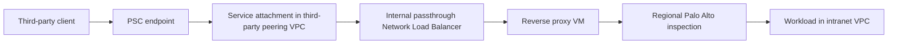

# ADR: Removing GCP Third-Party Ingress Reverse Proxies

| Field | Value |
| --- | --- |
| Status | Proposed — options analysis; no production cutover approved |
| Date | 2026-10-12 |
| Requested by | Maximilian Browne |
| Stakeholders | Network Security, Cloud Platform Engineering, Application Teams |
| Scope | Third-party PSC ingress into intranet workloads across two regions |
| Related | [GCP Internet Egress ADR](adr-gcp-internet-egress-architecture.md) — separate outbound use case, not superseded |

## Context

We want to remove the self-managed reverse proxies (RPs) from the third-party ingress path without accidentally removing inspection, changing the regional failure boundary, or losing required application behavior.

The owner-described current path is:



The two regional ingress environments share **one VPC**. An **untagged `10.0.0.0/8` static route** points to one regional Palo Alto (PA) path in `us-central1`. **Tagged routes on selected VMs** steer traffic toward the other regional PA path. **Return routes are configured for the current RP/PA path.** A static route is VPC-wide even when its next hop is regional. Replacing the RP changes the backend connection source, so the replacement path's effective forward and return routing must be validated; this does not imply that the current design lacks return routing.

The **current ILB is an internal passthrough Network Load Balancer**. Its frontend/backend network restriction is why the RPs bridge the current ingress path to the intranet workload VPC. The proposed direct backends are native VM/pod endpoints in the intranet VPC, **not another load-balancer VIP**. Exact project/Shared VPC resource ownership remains an implementation detail to resolve for a replacement. This baseline records the owner's confirmed architecture, not a claim of an independent production configuration audit.

**Protocol boundary:** native MariaDB client connections use the database wire protocol over TCP, optionally with TLS. They are not HTTP(S). Option D cannot serve direct MariaDB traffic and is included only for separate HTTP(S) services, not as a database-ingress candidate.

## Proposed decision

**Do not treat either a managed TCP proxy NLB or Cloud NGFW as a like-for-like RP replacement.** Keep the current path until one replacement passes the validation gates below.

- If full existing Palo controls and region-local inspection are mandatory, pursue **Option B with a routing/topology redesign**, not a frontend-only swap.
- If the security owner can accept a different enforcement model, evaluate **Option C, workload-side PSC publication with Cloud NGFW Enterprise**, as the managed RP-removal candidate.
- Use **Option D** only for HTTP(S) services where moving HTTP/TLS functionality to an Application Load Balancer is intentional. Exclude it for native MariaDB connections.
- Reserve **Option E** for a single-VM service that explicitly does not require backend health-based failover.

This is a recommendation for evaluation, not an assertion that the organization has selected Cloud NGFW or accepted any feature gap.

## Decision drivers

1. Remove RP patching, scaling, and lifecycle overhead.
2. Preserve the required exploit/malware prevention and application controls, not just TCP reachability.
3. Preserve regional PA placement or explicitly accept centralized inspection and its latency/failure domain.
4. Support the actual VPC **and project** boundaries with documented backend types.
5. Prove the consumer-to-workload path independently of native backend health checks.
6. Preserve required TLS, hostname selection, client identity, timeouts, and connection behavior.

## Options

| Option | RP removed? | Inspection model | Main issue / disposition |
| --- | --- | --- | --- |
| A. Retain current RPs | No | Existing regional Palo path | Operational baseline and rollback; retains RP overhead |
| B. Regional internal TCP proxy NLB + Palo | Yes, if all RP functions are replaced | Routed Palo backend connection | Cross-VPC capable, but cannot inherit tagged regional steering; routing redesign required |
| C. Workload-side PSC + passthrough NLB + Cloud NGFW Enterprise | Yes | Policy-driven inspection at workload interface | Changes publication boundary and security operating model; feature/TLS acceptance required |
| D. Regional internal HTTPS Application Load Balancer | HTTP(S) services only; no for native MariaDB | Conditional routed PA transit after routing redesign, or separate workload-side Cloud NGFW enforcement | Not a MariaDB/TCP proxy; same Envoy tagged-route limitation as B; no automatic PA insertion |
| E. Workload-side PSC + internal protocol forwarding + Cloud NGFW | Yes | Workload-interface inspection | Single target VM, no native backend health checks or health-based failover |

### Option A — Retain the current RPs

Keep PSC publication and RP VMs in the third-party peering VPC. The VMs continue to use the existing tagged/untagged route model toward the appropriate PA.

**Benefits:** least architecture change; preserves a controllable VM routing source and whatever TLS, DNS, header, logging, and application functions the RPs currently provide.

**Costs:** does not meet the removal objective; retains compute, patching, availability, and RP configuration ownership. Existing behavior still needs an inventory rather than an assumption that every RP is merely a TCP relay.

**Disposition:** baseline/rollback, not the desired end state.

### Option B — Regional internal TCP proxy NLB with native cross-VPC backends and Palo

```text
Third party → PSC → service attachment → regional TCP proxy NLB
           → proxy-only subnet → selected route → PA → intranet VM/pod
```

Native `GCE_VM_IP_PORT` backends can be in a different connected VPC. For the regional product, the NEG/instance group must satisfy the backend service's same-project/same-region requirements. Cross-VPC support is not unrestricted cross-project referencing; the internal TCP proxy does not provide an arbitrary frontend-project/backend-service-project split. Resolve the intended intranet-project resource ownership before selecting this option. [TCP proxy backend networking](https://docs.cloud.google.com/load-balancing/docs/tcp/internal-proxy#backends_and_vpc_networks).

**Routing blocker for the current design:** managed Envoy proxies cannot use VM-tagged static routes. The untagged `10/8` route remains eligible, so both regions could use the one baseline PA path; the other region's tagged override is ignored regardless of priority. This loses current regional steering, but does **not** prove all connectivity is impossible. [Static route applicability](https://docs.cloud.google.com/vpc/docs/static-routes#route_parameters).

Ways to make this option concrete:

- **B1: Accept centralized inspection.** Deliberately use the baseline PA path for both regions, validate capacity, latency, return symmetry, and failure handling. If the PA next hop is an internal passthrough NLB, verify its global-access setting allows the other region. This is a changed availability/inspection design, not regional equivalence. [Next-hop constraints](https://docs.cloud.google.com/vpc/docs/static-routes#considerations_for_internal_passthrough_network_load_balancer_next_hops).
- **B2: Separate routing domains.** Evaluate separate regional ingress VPCs, each with its own untagged PA steering. This requires a supported connectivity, PSC, backend-project, and return-path design; ordinary peering is not a transitive inspection fabric.
- Do not substitute two untagged same-prefix routes with different priorities and expect source-region selection. Do not claim source-based/policy routing is an Envoy solution until its applicability to this managed source and topology is documented and proven.

**Additional constraints:**

- Direct subnet/peering routes can preempt the broad static route and bypass PA. Check the effective route to each backend, not merely whether `10/8 → PA` exists. [Route selection](https://docs.cloud.google.com/vpc/docs/routes#routing_order).
- Native VM/NEG health checks use Google's special probe paths, not the frontend VPC's PA route. A backend can remain healthy while the proxy-to-PA data path is broken. [Health-check paths](https://docs.cloud.google.com/load-balancing/docs/health-check-concepts).
- The proxy terminates **TCP**, not necessarily TLS: encrypted bytes can pass through with TLS remaining client-to-workload. It does not automatically expose plaintext to PA or Cloud NGFW. [TCP proxy operation](https://docs.cloud.google.com/load-balancing/docs/tcp/internal-proxy).
- Backend connections originate from the proxy-only subnet. Original client identity and any PROXY-protocol requirements need deliberate treatment; neither PSC nor proxying should be assumed to preserve the original packet source.

**Hostname targeting:** native zonal NEGs use IP/port, not DNS-driven membership. Regional `INTERNET_FQDN_PORT` NEGs support private Cloud DNS resolution, including DNS peering, but the documented PSC producer compatibility list for a regional TCP proxy NLB **does not list regional internet NEGs**. Therefore a private hostname NEG is not an established supported replacement behind this PSC producer. [Regional FQDN endpoints](https://docs.cloud.google.com/load-balancing/docs/negs/internet-neg-concepts), [PSC producer compatibility](https://docs.cloud.google.com/vpc/docs/about-vpc-hosted-services#producer-configuration).

**Disposition:** conditional candidate; not a drop-in for the present two-region routing design.

### Option C — Publish PSC in the workload VPC with Cloud NGFW Enterprise

```text
Third party → PSC → service attachment in workload VPC
           → internal passthrough NLB → workload VM/pod
                                         ↕ policy interception
                              zonal Cloud NGFW Enterprise endpoint
```

Place the producer frontend and its direct native backends in the workload VPC. Unlike a proxy NLB, an internal passthrough NLB requires backend/frontend network consistency; peering does not allow retaining the frontend in the third-party VPC and attaching an arbitrary intranet-VPC NEG. [Passthrough NLB network rules](https://docs.cloud.google.com/load-balancing/docs/internal#backend_service_network_rules).

Inspection is **policy-driven packet interception at the protected workload interface**, not a static route to a firewall endpoint. Provision/associate endpoints in each protected workload zone and configure an effective `apply_security_profile_group` rule. Enterprise inspection is not supplied by ordinary L3/L4 allow rules. The security-profile action is not supported in regional network firewall policies; use a supported global/hierarchical policy arrangement. [Enterprise inspection](https://docs.cloud.google.com/firewall/docs/about-intrusion-prevention), [Rule actions](https://docs.cloud.google.com/firewall/docs/firewall-policies-rule-details#action).

For the passthrough PSC producer path, policy matching must account for the producer PSC NAT subnet source and the forwarding-rule VIP destination. Target the correct workload interfaces; do not substitute the original consumer IP or VM primary IP without checking the packet path. A proxy producer instead presents proxy-only-subnet sources and backend endpoint destinations. [Ingress targets and addresses](https://docs.cloud.google.com/firewall/docs/firewall-policies-rule-details#targets-and-ip-addresses-for-ingress-rules).

**Benefits:** removes RP and central-PA transit from this service path; avoids needing Envoy to reproduce VM-tagged routes; puts managed inspection near the protected workload.

**Costs/conditions:** changes publication/network ownership and enforcement model; requires zone coverage, policy operations, logs, TLS planning, cost/throughput review, and the feature-gap acceptance below. Moving the service attachment to another VPC cannot be treated as an in-place target-service swap: Google's replacement constraints require the same VPC and region, so plan consumer migration/new publication as appropriate. [Published-service replacement constraints](https://docs.cloud.google.com/vpc/docs/about-vpc-hosted-services#service-mutability).

**Disposition:** managed candidate for a POC, only if replacing Palo for this traffic is acceptable.

### Option D — Regional internal HTTPS Application Load Balancer

**Not applicable to native MariaDB ingress.** An internal Application Load Balancer accepts HTTP(S) and forwards supported HTTP-family backend traffic, not the MariaDB/MySQL wire protocol. Selecting port `3306` or enabling database TLS does not make a MariaDB listener an HTTPS backend. Putting an HTTP API in front of MariaDB would change the application/service contract and would not be a direct replacement for database TCP access. [Internal ALB protocol scope](https://docs.cloud.google.com/load-balancing/docs/l7-internal).

For separate HTTP(S) services, move required reverse-proxy functions to a regional internal Application Load Balancer and use a supported backend arrangement. The ALB terminates client TLS. An HTTP backend leg is plaintext; HTTPS creates a separate encrypted backend connection. [Internal ALB TLS behavior](https://docs.cloud.google.com/load-balancing/docs/l7-internal#target_proxy).

Palo inspection would require the actual backend connection to follow this path:

```text
PSC → regional HTTPS ALB → proxy-only subnet
    → effective applicable route → PA → HTTP(S) workload
```

**The ALB does not insert PA automatically and does not fix the current routing problem.** Like Option B, its managed Envoy sources cannot use the VM-tagged regional PA overrides. The shared VPC's applicable untagged baseline could provide centralized PA transit, subject to route precedence, next-hop reachability, and validation of the replacement connection's return path. Preserving region-local PA transit requires a supported steering/topology redesign. Native VM/NEG health checks remain distinct from this application path. [Static route applicability](https://docs.cloud.google.com/vpc/docs/static-routes#route_parameters), [Route selection](https://docs.cloud.google.com/vpc/docs/routes#routing_order).

An HTTP backend leg provides plaintext **only to an inspector actually on that leg**. An HTTPS backend leg remains encrypted unless separately decrypted. Certificate ownership and TLS/mTLS/application compatibility require validation. Workload-side Cloud NGFW is an alternative policy-interception model, not evidence that traffic traverses the existing Palo appliances.

The PSC regional ALB producer list includes regional internet NEGs, unlike the TCP producer list. This is a possible hostname-based **HTTP(S)** design, not proof that arbitrary TCP hostname proxying can be kept unchanged.

**Disposition:** HTTP(S)-only candidate with the same PA routing redesign requirement as B if existing regional Palo traversal is retained. Excluded for direct MariaDB/database wire-protocol traffic.

### Option E — PSC with internal protocol forwarding to one workload VM

Published services consumed by PSC **endpoints** can use internal protocol forwarding with a target instance. A regional forwarding rule targets one VM through a target-instance resource in the same VPC/region; the VM must accept the forwarding IP. There is no backend-service health checking or automatic healthy-backend selection. Apply workload-side Cloud NGFW as in Option C if this is the chosen inspection model. [Protocol forwarding](https://docs.cloud.google.com/load-balancing/docs/protocol-forwarding), [PSC endpoint producer support](https://docs.cloud.google.com/vpc/docs/about-vpc-hosted-services#producer-configuration).

**Disposition:** narrow single-VM case, not equivalent to a highly available multi-backend producer. PSC consumer-load-balancer/NEG compatibility differs from endpoint compatibility; do not generalize this option to every consumer pattern.

## Cloud NGFW versus existing Palo controls

Cloud NGFW Enterprise uses Palo Alto threat signatures, but that does **not** establish full PAN-OS or Advanced Threat Prevention parity. Compare the actual Panorama profiles, exceptions, subscriptions, and applications before accepting substitution.

| Capability | Documented Cloud NGFW behavior / issue | Required acceptance |
| --- | --- | --- |
| IPS tuning | Severity, threat-ID and antivirus-protocol overrides; narrower exposed tuning than PAN-OS category/CVE/host selection, per-signature IP exemptions and editable brute-force thresholds | Recreate necessary scoped exceptions through supported policy/profile arrangements; identify any unavailable control |
| Custom signatures | No equivalent custom vulnerability/spyware signature authoring exposed in the documented threat profile | Inventory custom signatures and retain another enforcement point if needed |
| Response actions | Default, Allow, Alert, Deny; not equivalent exposed reset-client/server/both or timed Block IP controls | Confirm required prevention behavior, not just signature presence |
| Threat forensics | No equivalent threat-profile setting for PAN single/extended threat packet capture identified | Validate required investigation workflow using available logging/capture tooling |
| Antivirus | Default action is **Alert** | Explicitly configure and prove required blocking |
| URL filtering | Separate URL profile exists for configured domain/wildcard/Host/SNI matches; PAN-DB category/risk equivalence is not established | Do not claim URL filtering is absent; compare the actual policy semantics |
| File controls | WildFire-based advanced malware sandbox/inline ML exists in **Preview**; not generic blocking of a file type regardless of verdict | Distinguish malicious-file prevention from File Blocking; validate Preview acceptance and supported files |
| DLP / application controls | PAN Data Filtering/DLP and the existing application-policy semantics are not demonstrated equivalents of a threat-prevention profile | Inventory the controls used today; do not infer parity from vendor branding |

Sources: [GCP security profiles](https://docs.cloud.google.com/firewall/docs/about-security-profiles), [Threat/antivirus behavior](https://docs.cloud.google.com/firewall/docs/about-threats), [URL filtering](https://docs.cloud.google.com/firewall/docs/about-url-filtering), [Malware sandbox](https://docs.cloud.google.com/firewall/docs/about-wildfire), [PAN security profiles](https://docs.paloaltonetworks.com/network-security/security-policy/administration/security-profiles), [PAN vulnerability tuning](https://docs.paloaltonetworks.com/network-security/security-policy/administration/security-profiles/security-profile-vulnerability-protection/configure-a-vulnerability-protection-profile-pm), [PAN custom signatures](https://knowledgebase.paloaltonetworks.com/KCSArticleDetail?id=kA14u000000CqQ1CAK&lang=en_US), [PAN threat captures](https://docs.paloaltonetworks.com/ngfw/administration/monitoring/take-packet-captures/take-a-threat-packet-capture).

### Encryption is a separate decision

PSC, TCP proxying, and NGFW attachment do not automatically decrypt payloads. Cloud NGFW TLS inspection uses certificate substitution and requires client trust in the inspection CA. Validate third-party trust distribution, pinning and mTLS rather than assuming those clients are enterprise-managed.

Google documents that TLS inspection does not support **HTTP/2, QUIC/HTTP/3 or PROXY-protocol traffic**, and does not decrypt SSH. These can be adoption blockers even where threat signatures are sufficient. [TLS inspection prerequisites and limitations](https://docs.cloud.google.com/firewall/docs/about-tls-inspection).

## Alternatives not accepted as shortcuts

- **Cross-VPC passthrough backends:** incompatible with the frontend/backend network requirements; use a different placement or supported proxy layout.
- **Hybrid NEG to make native GCP targets use Envoy health checks:** hybrid endpoints are for supported non-GCP resources, not an escape hatch for native VMs or internal forwarding-rule VIPs. [Hybrid NEG limitations](https://docs.cloud.google.com/load-balancing/docs/negs/hybrid-neg-concepts).
- **TCP proxy automatically forces decryption:** false; TCP and TLS termination are separate.
- **Healthy native NEG proves Palo transit:** false; probe and application paths differ.
- **Higher-priority tagged routes fix Envoy steering:** false; the routes are inapplicable to that source.
- **Cloud NGFW as a routed PA next hop:** wrong model; inspection is policy interception, and NGFW does not create missing cross-VPC connectivity.

## Validation and rollout gates

Before removing any RP:

1. **Inventory RP functions:** TCP versus HTTP proxying, TLS termination, mTLS, DNS/FQDN selection, authentication, header rewriting, source identity, timeouts, connection pooling, and logging.
2. **Resolve resource ownership:** identify exact frontend/backend VPCs, projects, regions, NEG types, Shared VPC relationships, and PSC endpoint versus consumer-LB patterns. Confirm the chosen producer/backend combination is supported.
3. **Validate replacement routing:** use the configured current RP/PA return routes as the baseline; capture the candidate's effective routes, tags, numeric priorities, PA next-hop type, global-access settings where relevant, route exchanges, and return routes for its changed source addresses. Prove inspection cannot be bypassed by a more specific/direct route. This gate does not describe existing return routing as absent or unknown.
4. **Audit security parity:** map every currently required Palo profile and exception to supported controls, a compensating control, or an explicit gap acceptance. Check TLS/client compatibility and malware-block actions.
5. **POC both regions:** run application transactions through actual PSC consumers. Correlate proxy/workload flow logs with PA or NGFW inspection logs. A direct backend health probe is insufficient evidence.
6. **Exercise failures:** fail the PA/data path while backend probes remain healthy; test zone/region/backend loss, endpoint failure behavior, draining, long-lived connections, and return-path symmetry. Establish end-to-end synthetic monitoring and the intended fail-closed/failover result.
7. **Plan migration and rollback:** parallel publication/canary consumers where needed, preserve the existing RP path, define rollback triggers, and remove only the migrated RPs after acceptance. No infrastructure change is authorized by publishing this ADR.

## Open decisions

- Is region-local PA traversal mandatory, or is a deliberate `us-central1` inspection hairpin acceptable?
- Is Cloud NGFW replacing Palo permitted for this traffic, and which profile gaps are disqualifying?
- What project/resource boundaries and backend resource types will the replacement use? The current ILB type is confirmed as internal passthrough.
- Which RP functions, TLS modes, application protocols and hostname requirements must survive?
- Can publication move into the workload VPC, and who owns service attachments, consumer migration, inspection policy, and operational support?
- What availability, throughput, latency, cost, Preview-feature, and fail-closed criteria must the POC meet?

## Consequences

Removing RPs is feasible through supported managed designs, but it transfers responsibilities rather than erasing them. Option B preserves Palo only after its routing and project-layout constraints are solved. Option C removes the central transit requirement but introduces a different security/control model. Option D changes the HTTP(S) application/TLS boundary and is not an option for native MariaDB ingress. Option E trades load-balanced availability for simplicity.

The current **single-VPC untagged baseline plus VM-tagged regional override** is the decisive reason a managed proxy NLB cannot simply replace the RPs unchanged. Cloud NGFW feature and encryption coverage are a separate decision, not a remedy for an unsupported network layout.
