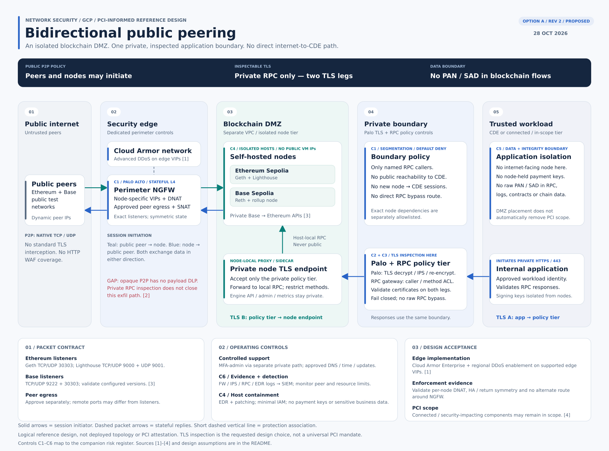
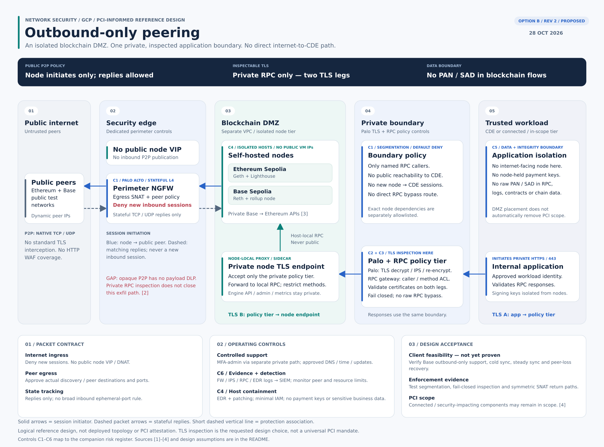

# GCP public blockchain P2P — DMZ NetSec review

**Status:** Proposed / draft. **Reviewed:** 28 October 2026. Controls, owners and client feasibility are not implementation evidence, risk acceptance or PCI signoff.

## NetSec position

Prefer **B: outbound-only peering** if the exact client stack supports reliable sync and recovery. If peer-initiated ingress is justified, **A** publishes only approved node-specific listeners through the dedicated perimeter. Both isolate the nodes and enforce the private RPC boundary.

**Scope assumption:** ordinary Ethereum Sepolia (Geth + Lighthouse) and Base Sepolia (Reth + rollup) data/RPC nodes, not validators, sequencers or payment-signing services. Confirm actual versions, roles, RPC data and dependencies before applying this review. No internal addresses or deployed topology are asserted.

**Material limits:** private Palo TLS inspection/IPS does not provide content-based DLP on encrypted public P2P, and it does not prove that a node's RPC answers are truthful. If sensitive node-readable data must never leave over permitted public channels, this design does not establish that property.

## Design options

The layouts use matching trust zones and control IDs. Arrows show session initiation, not one-way payload movement; replies traverse the same enforcement. Native P2P is not ordinary inspectable HTTPS.

### A — Bidirectional public peering

Peer-initiated and node-initiated TCP/UDP sessions cross the stateful perimeter. Publish only approved per-node VIP/listener mappings; keep node VMs private. Validate Cloud Armor Enterprise advanced network DDoS support on the actual perimeter public-IP placement, regional enablement, NAT symmetry and failover. Cloud Armor is edge protection, not a routed next-hop appliance.

[Open full-size SVG](diagrams/gcp-blockchain-p2p/01-bidirectional.svg)

### B — Outbound-only peering

No published node VIP, inbound DNAT or unsolicited public sessions. Permit documented node-initiated peer/discovery connections and tracked TCP/UDP replies. This reduces exposure, not hostile peer input or opaque-channel exfiltration. Lighthouse explicitly supports NAT without mappings; **the full Base stack's outbound-only operation remains unverified**.

[Open full-size SVG](diagrams/gcp-blockchain-p2p/02-outbound-only.svg)

### Shared private boundary

The private policy tier is a logical combination of **Palo TLS decryption/IPS/re-encryption (C2)** and **separate RPC caller/method/parameter/resource controls (C3)**. Do not credit JSON-RPC business authorization to ordinary IPS alone. Apps initiate private HTTPS to this tier; only the tier reaches node-side TLS endpoints, which forward to local RPC. Additional proxy hops may create additional TLS sessions: validate certificate trust, caller identity, client-auth/mTLS compatibility and request/response inspection. Fail closed, with no silent decryption exclusion, raw RPC bypass or direct route around enforcement.

Deny general node-initiated enterprise access. Explicit Base-to-Ethereum APIs, administration, DNS/time/updates and telemetry need separate narrow policies. No payment-signing keys, PAN/SAD or unnecessary sensitive business data belong on these nodes. A DMZ does not automatically remove PCI scope.

## Risk register

All eight items remain open until implementation and test evidence exists. Proposed role owners are not assignments; no likelihood scores or residual-risk acceptance are invented. [One-page risk graphic](diagrams/gcp-blockchain-p2p/03-risk-register.svg) · [Three-page diagram/register PDF](diagrams/gcp-blockchain-p2p/blockchain-dmz-review.pdf).

| ID / risk | Controls and coverage | Residual gap | Proposed owner / state |
|---|---|---|---|
| **R1 — Node process / host takeover** A + B · C1, C4, C6 | L4 limits exposed services; patching, hardened hosts and EDR reduce or detect compromise. SIEM supports response. | No decrypted P2P exploit coverage is credited. Malicious input still reaches the client over allowed sessions; EDR can miss it. | Endpoint + SecOps; NetSec supports. **Partial / open.** |
| **R2 — Exfiltration over allowed P2P** A + B · C1, C3, C4, C5 | Keep sensitive inputs, signing keys and broad credentials off nodes. Narrow RPC data contract and IAM limit what can be read. | No guaranteed content-based prevention on opaque public P2P. Data readable by a compromised node may leave; outbound-only does not fix it. | Project risk owner; App + Cloud + NetSec. **Material gap / open.** |
| **R3 — Pivot into CDE or cloud services** A + B · C1, C2, C4 | Separate VPC, node-level rules and segmentation deny new node-to-workload sessions. Minimal cloud identity limits API access. | Permitted RPC responses and explicit dependencies remain attack paths. Cloud IAM exposure must be tested, not inferred from IP isolation. | NetSec + Cloud IAM; App validates replies. **Partial / open.** |
| **R4 — RPC abuse or sensitive requests** A + B · C2, C3, C5 | Private Palo decrypts / IPS / re-encrypts. Separate RPC gateway authenticates callers, restricts methods and validates inputs / resource use. | TLS inspection is not business-data authorization. Generic IPS is not JSON-RPC DLP. Allowed inputs are visible to the node. | App / API platform; NetSec owns Palo. **Partial / open.** |
| **R5 — False RPC results / peer isolation** A + B · C4, C5, C6 | Secure transport and monitoring protect the path. Application validation and independent verification are needed for material decisions. | A compromised node can lie without changing the blockchain. TLS / IPS cannot certify chain truth; independent checks are not yet specified. | Application owner; Blockchain engineers. **Not resolved by NSCs.** |
| **R6 — DDoS, resource exhaustion, outage** A + B · C1, C3, C4, C6 | A: Cloud Armor advanced network DDoS protects supported edge IPs. Both: connection / peer / RPC limits, capacity alerts and recovery controls. | Network DDoS protection does not stop every valid-but-expensive peer request. B removes public listeners, not peer-driven exhaustion. | NetSec + Platform; SecOps monitors. **Partial / open.** |
| **R7 — Control bypass / unproven PCI scope** A + B · C1–C6 | Default-deny paths, private endpoints, no bypass routes, fail-closed inspection and centralized evidence support segmentation testing. | Misrouting, public IPv6, TLS exclusions or broad rules can bypass controls. DMZ is not automatically out of PCI scope. | NetSec + PCI owner; Platform implements. **Evidence pending.** |
| **R8 — Unworkable client / NAT assumptions** A + B · C1, C6 | A: prove per-node publication, NAT symmetry and failover. B: prove cold sync, steady sync and peer-loss recovery for the exact stack. | No deployment tests performed. Base outbound-only support and exact Cloud Armor / appliance / HA placement remain unverified. | Blockchain + Platform; NetSec validates path. **Feasibility pending.** |

## Control map

- **C1 — NetSec:** public perimeter/stateful L4, DMZ segmentation, node-specific native firewall policy; A publishes exact listeners, B denies new public ingress.
- **C2 — NetSec:** private Palo TLS decryption, supported IPS/security profiles, re-encryption, certificate policy and fail-closed enforcement. Inspect request and response directions; test exact TLS/client-auth compatibility.
- **C3 — Application/API platform:** separate RPC authentication, method/namespace policy, parameter/data validation, batch/size/rate limits. Do not credit these to ordinary Palo IPS alone.
- **C4 — Endpoint/Cloud:** EDR (for example CrowdStrike, if deployed and validated), patching, host isolation, least-privilege cloud identity, no payment-signing keys or sensitive data on nodes. EDR is not guaranteed prevention.
- **C5 — Application:** prevent sensitive data entering the node; validate responses and define independent verification/finality checks for decisions that require trustworthy chain state.
- **C6 — NetSec/SecOps/Platform:** A-specific upstream network DDoS protection, both-option monitoring/limits, logs and tested routing/segmentation/failover.

## Decision gates

1. **Project / application:** confirm client roles, versions, actual peer ports, allowed RPC methods/data, IAM and decision criticality. Define independent verification for material blockchain-derived decisions.
2. **NetSec / API platform:** prove private TLS/IPS in both directions, separate RPC authorization/data/resource controls, no bypasses and fail-closed handling of unsupported TLS modes.
3. **Platform / NetSec / SecOps:** test segmentation, IAM blast radius, alerts, rebuild/isolation and return-path symmetry. A additionally needs supported DDoS/VIP/NAT/HA placement. B needs full-stack cold sync, steady sync and peer-loss recovery.
4. **Accountable project / business owner and PCI function:** evaluate residual exfiltration/integrity risk and actual PCI scope. This document is not approval, and TLS interception is the requested design choice rather than a universal PCI mandate.

## Primary sources

- **[1] GCP:** [advanced network DDoS](https://docs.cloud.google.com/armor/docs/advanced-network-ddos), [stateful firewall policy](https://docs.cloud.google.com/firewall/docs/firewalls), [VM service-account access](https://docs.cloud.google.com/compute/docs/access/service-accounts).
- **[2] Inspection:** [RLPx encryption](https://github.com/ethereum/devp2p/blob/master/rlpx.md), [Geth RPC security](https://geth.ethereum.org/docs/fundamentals/security), [Palo decryption and security profiles](https://docs.paloaltonetworks.com/network-security/decryption/administration/decryption-overview).
- **[3] Clients:** [Geth peers](https://geth.ethereum.org/docs/fundamentals/peer-to-peer), [Lighthouse NAT](https://lighthouse-book.sigmaprime.io/advanced_networking.html), [Base operator requirements](https://docs.base.org/specifications/node-operators/run-a-node).
- **[4] PCI SSC:** [scope/segmentation guidance](https://www.pcisecuritystandards.org/faqs/1115/), [intrusion-detection guidance](https://www.pcisecuritystandards.org/faqs/1074/), [current standards library](https://www.pcisecuritystandards.org/document_library/?category=pcidss).

Sources reviewed 28 October 2026. Risks are architectural analysis, not assertions of an observed incident. The diagrams were XML-checked, rendered and visually inspected; no cloud infrastructure was changed.
